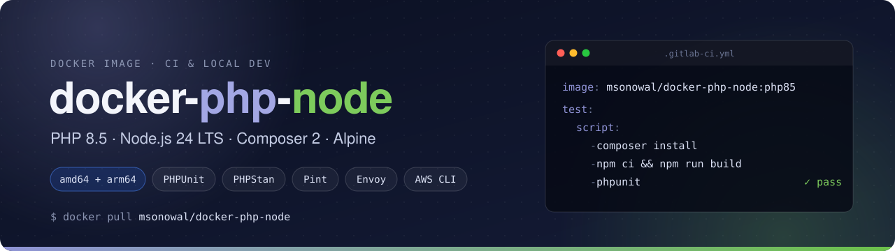

<p align="center">
  
</p>

<p align="center">
  <a href="https://github.com/msonowal/docker-php-node/actions/workflows/docker-image.yml"></a>
  <a href="https://hub.docker.com/r/msonowal/docker-php-node"></a>
  <a href="https://hub.docker.com/r/msonowal/docker-php-node/tags"></a>
  
  
  
  <a href="https://github.com/msonowal/docker-php-node/pkgs/container/docker-php-node"></a>
</p>

A ready-to-go image for **building and testing PHP / Laravel apps** in CI (GitLab CI, GitHub Actions, Bitbucket, …) and locally. PHP, Composer, Node.js, npm, Yarn and the usual QA tools are already installed, so jobs can start on `composer install` instead of on setup.

Built on the official `php:<version>-fpm-alpine` image, for `linux/amd64` and `linux/arm64`.

## Quick start

```bash
docker run --rm -it -v "$PWD":/app -w /app msonowal/docker-php-node:php85 sh
```

Also published to GitHub Container Registry:

```bash
docker pull ghcr.io/msonowal/docker-php-node:php85
```

### GitLab CI

```yaml
image: msonowal/docker-php-node:php85

test:
  script:
    - composer install --no-interaction --prefer-dist
    - npm ci && npm run build
    - vendor/bin/phpunit
```

### GitHub Actions

```yaml
jobs:
  test:
    runs-on: ubuntu-latest
    container: ghcr.io/msonowal/docker-php-node:php85
    steps:
      - uses: actions/checkout@v7
      - run: composer install --no-interaction --prefer-dist
      - run: npm ci && npm run build
      - run: vendor/bin/phpunit
```

## Tags

| Tag | PHP | Upstream PHP status |
| --- | --- | --- |
| `php85`, `latest`, `edge`, `main` | 8.5 | Active support |
| `php84` | 8.4 | Active support |
| `php83` | 8.3 | Security fixes only |
| `php82` | 8.2 | Security fixes only (until Dec 2026) |
| `php81` | 8.1 | End of life |
| `php8`, `php80` | 8.0 | End of life, image no longer rebuilt |
| `php74`, `php73`, `php72`, `php71` | 7.x | End of life, image no longer rebuilt |

`php85` / `latest` is rebuilt every week to pick up base image and package security fixes. Each older tag is built from the branch of the same name. Pin a `phpXY` tag in CI rather than `latest`, so a new PHP release doesn't change your build without warning.

Builds are also tagged `sha-<commit>`. Browse all tags on [Docker Hub](https://hub.docker.com/r/msonowal/docker-php-node/tags) or [GHCR](https://github.com/msonowal/docker-php-node/pkgs/container/docker-php-node).

## What's included

These are for the `php85` tag. Older tags are similar, with versions that fit their PHP release.

**PHP** with the development `php.ini`, plus these extensions on top of the official image's defaults:
`bcmath` `exif` `gd` `gmp` `intl` `mongodb` `opcache` `pcntl` `pcov` `pdo_mysql` `redis` `sockets` `zip`

**JavaScript:** Node.js 24 LTS (from Alpine's packages), npm and Yarn 1.22.22

**Composer 2**, plus these tools installed globally and on `PATH`:

| Tool | Command |
| --- | --- |
| [PHPUnit](https://phpunit.de) | `phpunit` |
| [phpcov](https://github.com/sebastianbergmann/phpcov) | `phpcov` |
| [PHPStan](https://phpstan.org) | `phpstan` |
| [Laravel Pint](https://laravel.com/docs/pint) | `pint` |
| [PHP_CodeSniffer](https://github.com/PHPCSStandards/PHP_CodeSniffer) | `phpcs` |
| [PHPMD](https://phpmd.org) | `phpmd` |
| [phpcpd](https://github.com/sebastianbergmann/phpcpd) | `phpcpd` |
| [Local PHP Security Checker](https://github.com/fabpot/local-php-security-checker) | `security-checker` |
| [Laravel Envoy](https://laravel.com/docs/envoy) | `envoy` |
| [Laravel Vapor CLI](https://docs.vapor.build) | `vapor` |

**Also:** AWS CLI v2, git, openssh-client, curl, zip / unzip

Code coverage uses `pcov`. Xdebug is not installed.

## Building locally

```bash
docker build -t docker-php-node .
```

CI builds `linux/amd64` and `linux/arm64` natively, each on its own GitHub-hosted runner, then merges them into one multi-arch tag. See [`.github/workflows/docker-image.yml`](.github/workflows/docker-image.yml).
